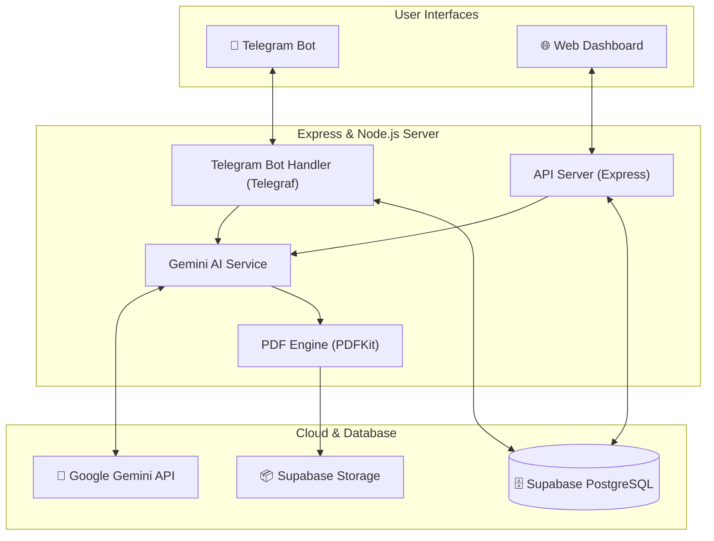

# 📚 Tuition Centre Worksheet Generator

An end-to-end, AI-powered platform designed for tuition centres, schools, and educators. This system parses textbook chapters, organizes curriculum content into semantic chunks, and automatically generates custom, publication-ready PDF worksheets with solution keys via a **Telegram Bot** and a **Web Dashboard**.

---

## ✨ Features

- 🤖 **Telegram Bot Interface (`Telegraf`)**:
  - Interactive step-by-step bot for generating worksheets on the go.
  - Multi-chapter selection support.
  - Difficulty selection (Easy, Medium, Hard).
  - Customizable question counts and targeted generation modes.
  - Real-time generation progress updates and instant PDF delivery in chat.

- 🌐 **Bulk Upload & Management Web UI**:
  - Clean web dashboard for uploading textbook chapter PDFs or raw text.
  - Automated PDF text extraction and semantic chapter chunking (Theory, Examples, Exercises, Facts).
  - Interactive chapter management and worksheet generation interface.

- 🧠 **AI-Powered Question Generation (Google Gemini)**:
  - Powered by **Google Gemini AI** (`gemini-2.5-flash`).
  - **Specialized Generation Modes**:
    - `similarity`: Mirrors textbook questions with altered numbers and scenarios.
    - `strict_grounded`: Questions built strictly from the provided textbook content.
    - `revision`: Summarized key concept questions and quick checks.
    - `challenge`: Higher-order thinking and complex problem-solving.
    - `weak_foundation`: Remedial, step-by-step foundation building questions.
  - Pre-built prompt engines for **Mathematics**, **Science**, **Information Technology**, **History**, **Communications**, and **Hindi Grammar**.

- 📄 **Publication-Ready PDF Engine (`PDFKit`)**:
  - Clean, professional typography and layout.
  - Custom font rendering support (including Devanagari/Hindi fonts like Noto Sans Devanagari).
  - Automated header branding, page numbers, question numbering, and optional answer keys.

- ⚡ **Caching & Deduplication**:
  - Hash-based caching (`MD5` of chapter IDs + difficulty + question count + prompt version + mode) in Supabase.
  - Prevents redundant AI API calls and reuses existing generated PDF assets.

- ☁️ **Cloud Database & Storage**:
  - Database schema built on **Supabase PostgreSQL**.
  - Supabase Storage integration for uploading and serving generated worksheet PDFs.

---

## 🛠️ Tech Stack

- **Backend**: Node.js, Express.js, TypeScript, Telegraf
- **AI Integration**: `@google/generative-ai` (Gemini API)
- **Database & Storage**: Supabase (PostgreSQL & Object Storage)
- **PDF Engine**: PDFKit, `pdf-parse`
- **Frontend**: HTML5, CSS3, Vanilla JavaScript

---

## 🏗️ System Architecture



---

## 🚀 Getting Started

### Prerequisites

Ensure you have the following installed and set up:

1. **Node.js**: `v18.x` or higher
2. **npm**: `v9.x` or higher
3. **Telegram Bot Token**: Created via [@BotFather](https://t.me/BotFather)
4. **Google Gemini API Key**: Obtained from Google AI Studio
5. **Supabase Project**: Free tier PostgreSQL database and Storage bucket

---

### Installation

1. **Clone the repository**:
   ```bash
   git clone https://github.com/your-username/worksheet-generator.git
   cd worksheet-generator
   ```

2. **Install dependencies**:
   ```bash
   npm install
   ```

---

### Environment Setup

Create a `.env` file in the project root directory (you can copy `.env.example`):

```bash
cp .env.example .env
```

Fill in your configuration credentials:

```env
# Telegram configuration
TELEGRAM_BOT_TOKEN=your_telegram_bot_token_here

# Google Gemini API key
GEMINI_API_KEY=your_gemini_api_key_here
GEMINI_MODEL=gemini-2.5-flash

# Supabase database configuration
SUPABASE_URL=https://your-supabase-project-id.supabase.co
SUPABASE_KEY=your_supabase_anon_or_service_role_key_here

# Web Server Port
PORT=3000
```

> ⚠️ **Note**: Do not commit your `.env` file to version control.

---

### Database Setup

1. Open your Supabase Dashboard and navigate to the **SQL Editor**.
2. Run the queries inside `schema.sql` to initialize the database tables and Row Level Security (RLS):

```sql
-- Chapters table
CREATE TABLE IF NOT EXISTS chapters (
  id UUID PRIMARY KEY DEFAULT gen_random_uuid(),
  telegram_user_id BIGINT,
  subject TEXT NOT NULL,
  class TEXT,
  board TEXT NOT NULL DEFAULT 'NCERT',
  chapter_name TEXT NOT NULL,
  summary JSONB,
  created_at TIMESTAMPTZ DEFAULT now()
);

-- Content Chunks table
CREATE TABLE IF NOT EXISTS chunks (
  id UUID PRIMARY KEY DEFAULT gen_random_uuid(),
  chapter_id UUID REFERENCES chapters(id) ON DELETE CASCADE,
  chunk_title TEXT,
  chunk_content TEXT NOT NULL,
  chunk_order INT NOT NULL,
  chunk_type TEXT NOT NULL
);

-- Generated Worksheets table
CREATE TABLE IF NOT EXISTS generated_worksheets (
  id UUID PRIMARY KEY DEFAULT gen_random_uuid(),
  hash TEXT NOT NULL UNIQUE,
  chapter_id UUID REFERENCES chapters(id) ON DELETE CASCADE,
  chapter_ids UUID[],
  difficulty TEXT NOT NULL,
  question_count INT NOT NULL,
  generation_mode TEXT NOT NULL,
  prompt_version TEXT NOT NULL,
  pdf_url TEXT NOT NULL,
  created_at TIMESTAMPTZ DEFAULT now()
);

ALTER TABLE chapters ENABLE ROW LEVEL SECURITY;
ALTER TABLE chunks ENABLE ROW LEVEL SECURITY;
ALTER TABLE generated_worksheets ENABLE ROW LEVEL SECURITY;
```

3. Create a public bucket named `worksheets` in **Supabase Storage** to store generated PDF files.

---

## 🏃 Running the Application

### Development Mode
Start the development server with live reload (`nodemon` + `ts-node`):
```bash
npm run dev
```

### Production Build
Compile TypeScript to JavaScript in `dist/`:
```bash
npm run build
```

Start the compiled production server:
```bash
npm run start
```

---

## 📁 Directory Structure

```
worksheet-generator/
├── public/                # Web Dashboard static assets (HTML, CSS, JS)
│   ├── index.html
│   ├── style.css
│   └── app.js
├── src/
│   ├── api/               # Express API endpoints
│   │   └── server.ts
│   ├── bot/               # Telegraf Telegram Bot handlers
│   │   └── index.ts
│   ├── db/                # Supabase database client & seed scripts
│   │   ├── index.ts
│   │   └── seedHindiGrammar.ts
│   ├── prompts/           # Subject-specific AI prompt templates
│   │   ├── communications.ts
│   │   ├── history.ts
│   │   ├── it.ts
│   │   ├── math.ts
│   │   ├── science.ts
│   │   └── promptVersions.ts
│   ├── services/          # Business logic services
│   │   ├── geminiService.ts
│   │   ├── pdfService.ts
│   │   └── storageService.ts
│   ├── types/             # TypeScript type definitions
│   └── utils/             # Helper utilities
├── fonts/                 # Custom font assets (e.g. Noto Sans Devanagari)
├── hosting_guide.md       # Deployment instructions guide
├── schema.sql             # PostgreSQL database schema
├── tsconfig.json          # TypeScript compiler configuration
└── package.json
```

---

## 🚢 Deployment

The service can be deployed on cloud platforms such as **Render**, **Railway**, or **Fly.io**.

- **Webhook Mode**: In production, set `WEBHOOK_URL` in environment variables. Telegram will push user events to your service, enabling auto-wake capabilities on free-tier hosting services.
- **Polling Mode**: Used automatically when `WEBHOOK_URL` is omitted (ideal for local development).

For detailed deployment steps on Render free tier, refer to [`hosting_guide.md`](file:///home/darren/Desktop/projects/worksheet-generator/hosting_guide.md).

---

## 📄 License

This project is licensed under the [ISC License](LICENSE).
